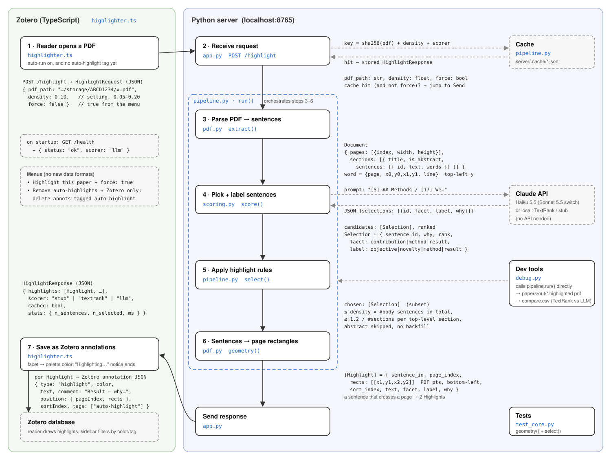

# Zotero Paper-Reading Plugin — Design Report

*CSCI 1377 final project (Ziqi Shen, Jean Yoo). Written 2026-11-14 after reviewing the proposal and a design-review ("grill-me") session. Presentation: Dec 15.*

This is the reference for **what we decided and why**, **what has to be built**, and **what is still open**. No work is assigned here on purpose.

---

## 1. Scope in one paragraph

A Zotero plugin that **highlights the important sentences in a paper automatically the first time its PDF is opened**, color-coded by *what kind* of sentence it is (Contribution / Method / Result), in the style of Scim (Fok et al., IUI 2023). A thin JS plugin handles Zotero; a local Python server does the work: parsing the PDF, choosing sentences (LLM), and computing highlight rectangles. Glossary (Goal 2) is the first stretch goal. Cornell notes (Goal 3) is the second stretch goal, and its minimal fallback is Zotero's existing notes pane.

---

## 2. Feasibility verdict

| Question | Answer |
|---|---|
| Can we do "JS wrapper + Python backend"? | **Yes.** The plugin is a thin TypeScript layer (similar tooling to our A4 Obsidian plugin: esbuild/TS). It sends the PDF's file path to a local Python HTTP server and turns the JSON it gets back into **native Zotero highlight annotations**. We never render highlights ourselves: they show up in the reader, sync, filter, and export like normal annotations. |
| Why does Python need to exist if an LLM does the reasoning? | **PDF text extraction with coordinates.** PyMuPDF gives each word's bounding box in a few lines. Doing this in JS means working with pdf.js internals, which is the JS-heavy work we want to avoid. |
| How much compute for surprisal (original idea)? | Small. A paper is about 10–15k tokens, and one forward pass of a small LM costs about 2 × params × tokens FLOPs. On our Intel i9 CPU: ~10–30 s (GPT-2 small) to ~3–5 min (1.5B model) per paper, done once and cached. **We are no longer using surprisal** (see §3, Q1). |
| Do we need OSCAR / a GPU cluster? | **No.** Nothing in the final design needs a GPU. OSCAR's SLURM queue would make a live plugin harder, not easier. |
| Do we need an API? | **Yes: the Claude API** (separate from a Claude.ai subscription; sign up at platform.claude.com, prepaid credits, API key). Cost per paper is about **$0.003 with Haiku 5.5** and about $0.06 with Sonnet 5.5 (rates as of Nov 2026). A few dollars covers the project. |
| Note on closed APIs and surprisal | Commercial APIs (Anthropic, OpenAI chat) don't return per-token log-probabilities for the text you send in, so true surprisal can't come from them. This was one reason to switch approach. |
| Machine caveat | Ziqi's Mac is **Intel** (i9-9880H, 16 GB). PyTorch stopped shipping Intel-Mac builds after 2.2.2. The current design needs **no torch**. Keep it that way, or pin carefully if local ML is ever added. Same problem with **PyMuPDF 2.x** (it depends on `onnxruntime`, which has no Intel-Mac builds), so the server pins `pymupdf>=1.28,<2` (1.28.2 installed). |
| Zotero version | Installed: **Zotero 10.0.9**. Checked on 2026-11-14: `windingwind/zotero-plugin-template`'s manifest declares `strict_min_version 8.0` and `strict_max_version 11.*`, so 10.x is supported. Still smoke-test on day one. |

---

## 3. Decision log

| # | Question | Decision | Why |
|---|---|---|---|
| Q1 | What's the "importance" signal? Is surprisal right? | **Drop surprisal.** Raw surprisal rewards noise (equations, citations, numbers, extraction junk) and gives *low* scores to formulaic key sentences ("we show that…"). | Surprising ≠ important in scientific prose. |
| Q2 | Which method? | **Scim-style faceted highlighting:** each sentence is labeled by facet, and the top ones are highlighted with one color per facet and a cap per section. | Published HCI prior work with its own user study; the colors tell the reader *why* a sentence is highlighted. |
| Q3 | LLM or fully local classifier? | **LLM does the classification** (Claude API). A local classifier (embeddings + logistic regression on CSAbstruct + TextRank) was judged too risky (domain shift, Intel-Mac ML stack). | Quality for the least effort. |
| Q3a | What runs before the LLM is wired in? | A **placeholder scorer** with the same function signature. It returns **TextRank** picks (or the first sentence of each paragraph), so the whole pipeline is tested with real sentences and positions. TextRank stays as the fallback and offline baseline. | Lets the plumbing be built in week 2 without an API key. |
| Q4 | How does the Python backend run? | **Start the server by hand** (`uv run uvicorn app:app --port 8765` in `server/`). The plugin checks `/health` and shows "Backend not running" if it's down. Auto-launch from the plugin was rejected: ~50–100 fiddly JS lines (macOS GUI apps don't inherit the shell PATH, orphaned processes, hidden logs) for no research value. | Demo runs on our machines only. |
| — | (Clarification) Did the A4 Obsidian plugin launch a server? | No. It was pure TS calling CourtListener's **remote** API through their SDK. Our server is different: we write it, and it runs on our own laptop. | — |
| Q5 | Trigger and lifecycle | **Auto-run on first open** of a PDF, plus a right-click **"Highlight this paper"** item and an **auto-run on/off** setting. "Only once" = skip if the attachment already has annotations tagged `auto-highlight`; the server also caches per PDF hash. **"Remove auto-highlights"** deletes them all (needed for tuning and re-runs). A "Highlighting…" notice shows while it runs. | No custom database needed: the annotations themselves are the record. |
| Q5a | How many colors? | **3 colors, 4 labels.** Contribution (Objective + Novelty) = purple, Method = blue, Result = green. The finer label is kept in the annotation comment (e.g. "Contribution · novelty"). Use **Zotero's built-in palette colors** (not yellow, which Zotero uses by default for manual highlights). | Fewer colors = less to decode while skimming. Objective and Novelty answer the same question ("what is this paper claiming to contribute?"). Zotero's sidebar filters by color/tag, which gives facet toggles for free. Verify in the Scim paper how it presented its four facets before citing it. |
| Q6 | PDF parsing | **PyMuPDF** with our own heuristics. GROBID (Docker) is Plan B if section or sentence detection is poor. Test papers: a **mix of one- and two-column**. | Pure Python, fast, fits the single-server setup. |
| Q7 | Highlight density | **One plugin setting, 5–20% of body sentences.** Build it as a dropdown first (5/10/15/20%), upgrade to a slider if time allows. **Per-section cap = 1.2 / (number of top-level sections)**: 60% for 2 sections, 40% for 3, 30% for 4, 24% for 5. Caps limit and never backfill. **Abstract is skipped.** Soft per-facet targets are optional. | Prevents one dense section from taking all the highlights. |
| Q7a | LLM call design | **One call per paper.** Input: numbered sentences grouped under section headings (references, captions, headers already removed). Output: structured JSON listing **only the selected sentences**: `id`, `facet`, short `why`. Drop invalid IDs. Default model Haiku 5.5, with Sonnet 5.5 as a one-line switch; compare both on 3–4 papers early. | Returning only selected sentences keeps output short → ~3–8 s latency instead of 15–30 s. |
| Q8 | Goals 2 vs 3 priority | **Glossary (Goal 2) before Cornell notes (Goal 3).** Glossary reuses the server and LLM, and its UI is a read-only list. Ground definitions in the paper (return the sentence ID where each term is defined) to limit made-up definitions. Goal 3 = all-new editable JS UI, and overlaps with Zotero notes. Goal 3's minimal fallback = **use Zotero's native notes pane** (zero work). | Same research story ("AI-assisted skimming and comprehension"). Related work: ScholarPhi (Head et al., CHI 2021). |
| Q9 | Evaluation | **Our own user study is on hold.** If needed, do a **qualitative analysis**: e.g. side-by-side LLM vs TextRank highlights on a few papers, plus a design walkthrough against Scim. Cite Scim's user study as **motivation** for the design, not as evidence that *our* implementation works. | Two-person team, short timeline; the plugin is the main deliverable. |
| Q10 | How many files? | **7 hand-written files**: 6 flat Python files in `server/` + 1 TypeScript file (`plugin/src/modules/highlighter.ts`) on top of the plugin template. Split a file only when it grows past ~400 lines. See §10. | A first scaffold had 33 hand-written files, which is unmanageable for two people in four weeks. Files follow what gets debugged together. |
| Q11 | Who writes the JS? | **Done (v1, 2026-11-14): Claude wrote `highlighter.ts` (~340 lines) and a minimal stub `app.py`.** Type-checked and the server tested with curl, but **not yet run inside Zotero**. Originally proposed as: Claude writes the JS layer (~250–330 lines incl. template edits; +80–120 for the glossary pane), *after* the JSON contract is fixed, developed against stub mode; we run `npm start` to verify. **Pending:** check CSCI 1377's AI-code policy and disclose it in the presentation. | The JS is Zotero-API glue, not the research contribution (that's `pdf.py`, `scoring.py`, `pipeline.py`). |

---

## 4. Architecture

```
Zotero 10 (JS plugin, thin)                    Python server (localhost, started by hand)
─────────────────────────────                  ──────────────────────────────────────────────
Reader tab opens (or "Highlight this paper")
  ├─ already has `auto-highlight` annots? → stop
  └─ POST /highlight {pdf_path, density} ───→  1. Parse PDF (PyMuPDF): words + bounding boxes
                                               2. Sections, skip abstract, cut References,
                                                  drop headers/footers/captions/equations,
                                                  rejoin hyphenated words, two-column reading order
                                               3. Split into sentences (e.g. pysbd)
                                               4. score_sentences(sections) → selections
                                                    • placeholder: TextRank
                                                    • real: one Claude API call ──────→ Anthropic
                                               5. Budget = density × #body sentences;
                                                  per-section cap = 1.2 / #sections
                                               6. Sentence → words → one rect per line;
                                                  flip y to bottom-left origin; sortIndex
                                               7. Cache by (PDF hash, density)
  ← JSON list of highlights ←─────────────────
Save each as a Zotero highlight annotation
(color by facet, comment = facet · why, tag `auto-highlight`)
```

**Shared contract (fix this in week 2 before splitting up):** request = PDF path + density. Each highlight in the response carries: page index, list of rectangles (PDF points, bottom-left origin), sentence text, facet, fine label, short reason, sort index. Once this is fixed, both sides can be built and tested independently (JS against a stub that returns fixed JSON; Python with `curl`).

### 4.1 Data flow and formats between files



*(Source: `docs/dataflow.svg`. Numbers match the steps below. Solid arrows = the main request path; dashed = side paths.)*

| # | From → To | How | What flows (fields) |
|---|---|---|---|
| 1→2 | `highlighter.ts` → `app.py` | HTTP `POST /highlight`, JSON | **HighlightRequest** `{ pdf_path: str, density: float (0.05–0.20), force: bool }`. `force=true` only from the "Highlight this paper" menu (skips cache, replaces old auto-highlights). |
| — | `highlighter.ts` ↔ `app.py` | HTTP `GET /health` | `{ status: "ok", scorer: "stub" \| "textrank" \| "llm" }`, checked on startup. |
| 2 ↔ cache | `app.py` / `pipeline.py` ↔ `server/.cache/` | JSON file on disk | Key = `sha256(pdf bytes) + density + scorer`. A hit returns the stored **HighlightResponse** and skips steps 3–6. |
| 2→3 | `app.py` → `pipeline.run()` → `pdf.extract()` | Python call | `pdf_path`, `density`, `force` |
| 3→4 | `pdf.py` → `scoring.py` | Python objects | **Document** `{ pages: [{index, width, height}], sections: [{ title, is_abstract, sentences: [{ id, text, words }] }] }`. **Word** `{ page, x0, y0, x1, y1, line }` in PyMuPDF coords (**top-left origin**). The scorer only receives the body (no abstract) as `[{ title, sentences: [(id, text)] }]` plus a target count N. |
| 4 ↔ API | `scoring.py` ↔ Claude | HTTPS | Prompt: numbered sentences grouped by section (`## Methods` / `[17] We trained…`). Reply: structured JSON `{ selections: [{ id, facet, label, why }] }`. TextRank/stub produce the same shape locally. |
| 4→5 | `scoring.py` → `pipeline.select()` | Python objects | Ranked **candidates: [Selection]**. **Selection** `{ sentence_id, facet: contribution\|method\|result, label: objective\|novelty\|method\|result, why: str, rank: int }`. Ask the scorer for ~1.5 × N so the caps don't run it dry. |
| 5→6 | `pipeline.select()` → `pdf.geometry()` | Python objects | **chosen: [Selection]**: a subset, ≤ density × #body sentences, ≤ 1.2 / #sections per top-level section, abstract skipped, no backfill. |
| 6→send | `pdf.geometry()` → `app.py` | Python objects → JSON | **[Highlight]**, each `{ sentence_id, page_index, rects: [[x1, y1, x2, y2]], sort_index: "PPPPP\|OOOOOO\|TTTTT", text, facet, label, why }`. Rects are in PDF points, **bottom-left origin** (y flipped here). A sentence that crosses a page break becomes **two** Highlights, because a Zotero annotation lives on one page. |
| send→7 | `app.py` → `highlighter.ts` | HTTP response, JSON | **HighlightResponse** `{ highlights: [Highlight], scorer, cached: bool, stats: { n_sentences, n_selected, ms } }` |
| 7→DB | `highlighter.ts` → Zotero | Zotero JS API | One **Zotero annotation** per Highlight: `{ type: "highlight", color: facet color, text, comment: "Result — why…", position: { pageIndex, rects }, sortIndex, tags: ["auto-highlight"] }` |
| dev | `debug.py` → `pipeline.run()` | Python call | Same inputs as step 2. Writes `papers/out/<name>.highlighted.pdf` and `papers/out/compare.csv` (TextRank vs LLM picks). |

**Conventions that keep the halves in sync**

- **Sentence `id`** is a single integer counter across the whole paper, assigned in `pdf.extract()`. Everything downstream (prompt, Selection, Highlight) refers to sentences only by this id. The LLM never returns text, so it can't make up sentences.
- **Coordinates:** top-left origin *inside* `pdf.py` (PyMuPDF), bottom-left origin *everywhere outside it* (flip in `geometry()`). Units are PDF points throughout.
- **Facet vs label:** `facet` (3 values) drives the color, and `label` (4 values) is the finer tag kept in the comment. The server never sends colors; `highlighter.ts` maps facet → color.
- **The JSON shapes (request, response, Highlight) are the contract.** Finalize them in `docs/api-contract.md`; the Document and Selection objects are internal to Python and can change freely.

---

## 5. Work to be done (unassigned)

### Plugin / JS side (Goal 1) — all in `plugin/src/modules/highlighter.ts` + template edits
*v1 written by Claude (Q11); still to verify inside Zotero. Course AI-code policy check pending.*
- [ ] Scaffold from `windingwind/zotero-plugin-template`; confirm it loads on **Zotero 10.0.9** (`strict_max_version`); set up hot reload.
- [ ] On startup: `/health` check → Zotero notice if the backend is down.
- [ ] Hook for when a reader opens → find the PDF attachment item and its file path.
- [ ] Skip if the attachment already has `auto-highlight` annotations.
- [ ] POST to `/highlight` with path + density; handle timeout and error; show a "Highlighting…" notice.
- [ ] Turn each result into a Zotero highlight annotation: position (page + rects), text, color, comment, tag, **sort index** (Zotero needs a specific string format, roughly `page|char-offset|top`; check against Zotero source/docs).
- [ ] Menu items: **"Highlight this paper"**, **"Remove auto-highlights"**.
- [ ] Settings pane: density (dropdown → slider later), auto-run toggle, server URL.
- [ ] Build and install the `.xpi` on the demo machine.

### Server / Python side (Goal 1)
- [ ] `uv` project + FastAPI app: `/health`, `/highlight`, stub mode. → `app.py`
- [ ] PyMuPDF extraction: words + boxes, two-column reading order, top-level section detection, abstract detection, References cutoff, header/footer/caption/equation filtering, rejoining hyphenated words. → `pdf.py`
- [ ] Sentence splitting + mapping sentence text back to word boxes → one rect per line. → `pdf.py`
- [ ] Coordinate conversion (y' = page_height − y) and sort-index values. **Day-one test:** one hard-coded rectangle shows up in the right place in Zotero. → `pdf.py` (+ `app.py` stub)
- [ ] Selection logic: density budget, per-section cap (1.2 / n), abstract skip, no backfill. → `pipeline.py`
- [ ] Placeholder scorer (TextRank via `sumy`, or first sentence per paragraph). → `scoring.py`
- [ ] LLM scorer: prompt, structured JSON output, facet labels, invalid-ID filtering, model switch (Haiku ↔ Sonnet). API key in `.env`, git-ignored. → `scoring.py`
- [ ] Cache by PDF hash + density. → `pipeline.py`
- [ ] **Debug script:** write the chosen highlights onto a *copy* of the PDF with PyMuPDF, so extraction and selection can be checked without Zotero. → `debug.py`
- [ ] Test set: ~5–10 papers, mix of one- and two-column (include the Assignment 2 Nature paper). → `papers/`
- [ ] Tests for geometry and selection rules. → `test_core.py`

### Tuning (after integration)
- [ ] Tune the prompt and density on the test set; compare Haiku vs Sonnet; compare against TextRank.

### Stretch 1 — Glossary (Goal 2)
- [ ] `/glossary` endpoint: LLM extracts key terms + short definitions **grounded in the paper**, returning the defining sentence ID. → `scoring.py` + `app.py`
- [ ] A reader side-panel section that renders the list; clicking a term jumps to its sentence (optional). → `highlighter.ts`

### Stretch 2 — Cornell notes (Goal 3)
- [ ] Minimal: use Zotero's native notes pane (nothing to build).
- [ ] Full: custom sidebar + bulk export (only if far ahead).

### Wrap-up
- [ ] Qualitative analysis (if needed): LLM vs TextRank highlights on 2–3 papers, design comparison with Scim. → `debug.py`
- [ ] Presentation and live demo (server started beforehand on the demo laptop).

---

## 6. Suggested phase plan (no owners)

| Dates | Milestone |
|---|---|
| Nov 14–15 | Placeholder plugin shell loads on Zotero 10; empty FastAPI `/health`; agree on the JSON contract. |
| Nov 16–22 | End to end with the **placeholder scorer**: open PDF → TextRank highlights appear as Zotero annotations. Coordinate flip and sort index verified. Remove/re-run menu items working. |
| Nov 23–29 | Thanksgiving (buffer). |
| Nov 30–Dec 6 | LLM scorer in; facets and colors; density setting; caps; tuning on the test set. |
| Dec 7–14 | Polish; stretch glossary if Goal 1 is solid; qualitative analysis; slides. |
| Dec 15 | Presentation. |

---

## 7. Risks and mitigations

| Risk | Mitigation |
|---|---|
| Two-column reading order / extraction junk ruins sentences | Debug-PDF script; check visually on mixed test papers; GROBID as Plan B. |
| Highlights mirrored or offset on the page | Day-one single-rectangle test; y-flip; watch for rotated pages and crop boxes. |
| Sort index format wrong → annotations listed out of order or rejected | Copy the format from Zotero source; Python computes it. |
| LLM latency > "a few seconds" | Return only selected IDs; Haiku; cache; progress notice. |
| LLM picks are poor or inconsistent | Structured output; numbered sentences; tune on test set; compare with TextRank. |
| Template incompatible with Zotero 10 | Low: the template declares 8.0–11.*. Smoke-test on day one anyway. |
| Non-paper or huge PDFs (books), scanned PDFs with no text layer | Skip with a notice above a page limit (e.g. 50 pages) or when no text is extracted. |
| Auto-highlights mixed with your own | Distinct tag + palette colors; "Remove auto-highlights". Be careful in **group libraries**: auto-annotations sync to other members. |

---

## 8. Open questions (still pending)

- Exact JSON field names for the contract (decide together in week 2).
- Density control: dropdown only, or real slider?
- How to present facets in the comment (e.g. "Contribution · novelty — main claim") and whether to include the LLM's reason.
- Whether to highlight the conclusion section, or treat it like the abstract.
- Whether Related Work should get any highlights at all (let the LLM decide, or exclude).
- Our own user study: **on hold**; only revisit if time and participants appear.
- Who writes the JS layer (Q11): confirm CSCI 1377's policy on AI-written code first.
- Verify from the Scim paper: its facet set, colors, and density control, before citing them in the presentation.

---

## 9. References / pointers

- **Scim:** Fok et al., *Scim: Intelligent Skimming Support for Scientific Papers*, IUI 2023 (Allen AI Semantic Reader). Facet highlighting, density control, user study.
- **ScholarPhi:** Head et al., *Augmenting Scientific Papers with Just-in-Time, Position-Sensitive Definitions of Terms and Symbols*, CHI 2021 (prior work for the glossary).
- **CSAbstruct:** Cohan et al., 2019, sequential sentence classification (Background / Objective / Method / Result / Other); useful if a local classifier is ever revisited.
- **TextRank:** Mihalcea & Tarau, 2004; Python `sumy` package (placeholder + baseline).
- **GROBID:** PDF → structured TEI with sentence coordinates (Plan B parser).
- **Zotero plugin template:** `windingwind/zotero-plugin-template` (+ `zotero-plugin-toolkit`).
- **Claude API:** platform.claude.com. Models: `claude-haiku-5-5` (default for scoring), `claude-sonnet-5-5` (quality comparison).

---

---

## 10. Repository scaffold (slim version)

**Rule: a file holds what gets debugged together.** There are **7 files we (or Claude) write by hand**. Everything else is generated (plugin template, `uv`) or is docs. Split a file only once it passes ~400 lines.

**Legend:** ✏️ = hand-written, placeholder already in the repo (one-line comment only). **[T]** = copied from the Zotero plugin template, don't hand-write. **[T✎]** = template file with small edits. **[uv]** = generated by `uv`.

```
zotero_plugin/
├── README.md                    project pointer → this report
├── .gitignore                   .env, .venv, node_modules, build output, papers/*.pdf
├── docs/
│   ├── design-report.md         this file
│   └── api-contract.md          /highlight (later /glossary) JSON contract — fill in together in week 2
├── papers/                      test PDFs (git-ignored)
│
├── plugin/                      ── Zotero plugin (TypeScript) ────────────────────────────
│   ├── README.md
│   ├── (template files)         [T]  package.json, tsconfig, addon/bootstrap.js, manifest.json, utils/ …
│   ├── zotero-plugin.config.ts  [T✎] plugin name / id / prefs prefix
│   ├── addon/prefs.js           [T✎] defaults: density, autoRun, serverUrl
│   ├── addon/content/preferences.xhtml  [T✎] settings pane: density dropdown, auto-run toggle, server URL
│   ├── addon/locale/en-US/*.ftl [T✎] menu / notice / pref labels
│   ├── src/hooks.ts             [T✎] on startup: health check + register hook & menus; on shutdown: clean up
│   └── src/modules/
│       └── highlighter.ts       ✏️ THE ONLY JS FILE: contract types, server client, reader-open hook,
│                                    create/remove annotations, facet colors, menus, notices (+ glossary pane later)
│
└── server/                      ── Python backend (FastAPI), flat — no package ───────────
    ├── README.md
    ├── pyproject.toml           [uv]
    ├── .env.example             ANTHROPIC_API_KEY=  (copy to .env, never commit .env)
    ├── app.py                   ✏️ routes (/health, /highlight), settings from .env, contract models, stub mode   ~100 lines
    ├── pdf.py                   ✏️ words+boxes, reading order, sections/abstract/References, cleanup,
    │                                sentence split, rect per line, y-flip, sortIndex                              ~300
    ├── scoring.py               ✏️ TextRank placeholder/baseline + Claude call + prompt (+ glossary later)        ~150
    ├── pipeline.py              ✏️ end-to-end run + density budget, per-section cap, abstract skip, cache        ~120
    ├── debug.py                 ✏️ draw highlights on a PDF copy; TextRank vs LLM side by side                   ~80
    └── test_core.py             ✏️ tests: geometry (rects, y-flip, sortIndex) + selection rules                  ~80
```

**Size:** about **830 lines of Python** (ours) and about **250–330 lines of TS/XHTML** (one file plus template edits; see Q11 for who writes it).

### Data flow through the files

See **§4.1** (diagram + table of what flows between each pair of files).

### Setup steps

1. **Plugin base:** done. The template is in `plugin/` with demo code removed. `plugin/.env` points at a separate dev profile and a separate dev library (`~/Zotero-dev`), so testing never touches the real library in `~/Zotero`. Quit the normal Zotero, then `npm start`.
2. **Server base:** already set up (`uv init --bare` + `fastapi`, `uvicorn`). Add the rest as each file is written: `uv add pysbd sumy anthropic python-dotenv` (PyMuPDF is already added, pinned below 2.0) and `uv add --dev pytest`. Run with `uv run uvicorn app:app --port 8765`. Tests: `uv run pytest`. Copy `.env.example` → `.env` and add the API key only when the LLM scorer goes in.
3. **First end-to-end milestone:** stub mode in `app.py` returns one hard-coded highlight → `highlighter.ts` draws it in the right place in Zotero. This tests the y-flip, sort index, and annotation saving before any parsing exists.

### Current state of the code (2026-11-14)

| File | State |
|---|---|
| `plugin/` (template + `highlighter.ts`) | **Set up and building.** Template copied in (demo code removed), plugin named *Paper Highlighter* (`paper-highlighter@csci1377.example`), `hooks.ts` wired to `highlighter.ts`, settings pane with density / auto-run / server URL. `npm run build` and the type check pass, producing `.scaffold/build/paper-highlighter.xpi`. **Not yet run inside Zotero.** `.env` is ready (dev profile + dev library), so next is `npm start`. |
| `server/app.py` | **Minimal stub working.** `GET /health`; `POST /highlight` validates the request (404 if the PDF is missing, 422 if density is outside 0.05–0.20), **appends it to `server/.cache/requests.jsonl`**, and returns one hard-coded highlight near the top of page 1. |
| `pdf.py`, `scoring.py`, `pipeline.py`, `debug.py`, `test_core.py` | Placeholders. |

**First Zotero test:** start the server, open any US-Letter PDF. A green "Result" highlight should appear near the **top** of page 1, and the request should appear in `requests.jsonl`. If the box is at the bottom, the y-flip is wrong. If saving fails, check the sort index (look in Zotero's Help → Debug Output).

### Why this layout

- **The contract is the only coupling** (`docs/api-contract.md` ↔ models in `app.py` ↔ types in `highlighter.ts`). The plugin can be built against stub mode; the server can be built with `curl` and `debug.py`.
- **Scorers are swappable** inside `scoring.py` (stub → TextRank → LLM via a setting), and TextRank stays available as the baseline.
- **Colors live only in the plugin.** The server returns facet labels, so presentation tweaks never touch Python.
- **`pdf.py` is the biggest risk and the biggest file.** If it outgrows ~400 lines, the natural split is `pdf_extract.py` (words, order, sections, cleanup) vs `pdf_geometry.py` (rects, y-flip, sortIndex).
